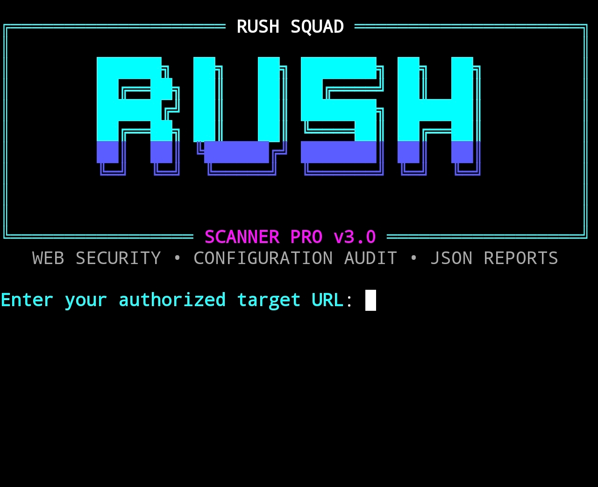

<p align="center">
  
</p>

<h1 align="center">Rush Squad Scanner PRO</h1>

<p align="center">
  Python-based Website Security Configuration Scanner
</p>

<p align="center">
  <a href="https://github.com/mahmofmdgbcjgjc-blip/Scanner-Web-">GitHub Repository</a>
  |
  <a href="https://discord.gg/eDDWHfYfFN">Official Discord</a>
</p>

## Features

- HTTP security headers analysis
- Cookie security attribute checks
- CORS configuration inspection
- HTTP redirect checks
- robots.txt inspection
- Sitemap.xml inspection
- Interactive colored terminal interface
- JSON report generation
- Configurable request timeout and limits
- Path exclusions
- Termux and Linux support

## Requirements

- Python 3
- requests
- rich

## Installation

Clone the repository:

```bash
git clone https://github.com/mahmofmdgbcjgjc-blip/Scanner-Web-.git
```

Enter the project directory:

```bash
cd Scanner-Web-
```

Install dependencies:

```bash
pip install requests rich
```

## Usage

Start the interactive interface:

```bash
python scanner.py
```

Scan an authorized target:

```bash
python scanner.py --url https://example.com
```

Save a JSON report:

```bash
python scanner.py --url https://example.com --report report.json
```

Configure request limits:

```bash
python scanner.py --url https://example.com --timeout 10 --max-requests 40
```

## Official Discord Server

Join the Rush Squad community for discussions, support, and updates.

https://discord.gg/eDDWHfYfFN

## Disclaimer

This tool is intended for educational purposes and authorized security testing only. Only scan websites you own or have explicit permission to assess. Findings may require manual verification.

## Author

Rush Squad
